<div align="center">

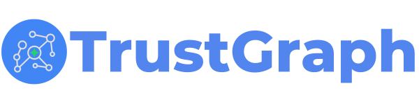

[](https://hub.docker.com/u/trustgraph) [](https://pypi.org/project/trustgraph/)  
[](https://discord.gg/kT5dAsaj8v)

[**Playground**](https://docs.google.com/forms/d/e/1FAIpQLSeTnF22ZjUP20FWV--VvS5606x-5cOvnKty6AqcPdtlnPuqbQ/viewform) | [**Self-Host**](https://config-ui.demo.trustgraph.ai/) | [**Docs**](https://docs.trustgraph.ai) | [**YouTube**](https://www.youtube.com/@TrustGraphAI?sub_confirmation=1) | [**Discord**](https://discord.gg/sQMwkRz5GX) | [**Website**](https://trustgraph.ai) 

### The Governance Platform for Agents, Knowledge, and Context

<a href="https://trendshift.io/repositories/17291" target="_blank"></a>

</div>

---

[TrustGraph](https://trustgraph.ai) turns enterprise knowledge, systems, and business logic into a unified ontology-grounded context graph and policy runtime that governs what AI agents can do.

### Understand. Govern. Verify.
- **Understand your business**: Build a connected graph of entities, relationships, policies, and evidence from documents and systems, using your own or domain-standard ontologies.
- **Govern agent actions**: Enforce explicit rules for authority, scope, risk, uncertainty, time, and value at the point of action.
- **Verify decisions**: Retain the evidence and policy versions needed to explain and reproduce each outcome.

## The Platform


## Ontologies Made Easy



## Understand Your Knowledge


## 3 RAG Techniques in a Single Platform


## Advanced Agentic Graph Traversal


## Semantic Policy Enforcement


## Provenance for Knowledge and Agent Actions



## Decisions without LLMs


## No API Keys Required

How many times have you cloned a repo and opened the `.env.example` to see the dozens of API keys for 3rd party dependencies needed to make the services work? There are only 3 things in TrustGraph that might need an API key:

- 3rd party LLM services like Anthropic, Cohere, Gemini, Mistral, OpenAI, etc.
- 3rd party OCR like Mistral OCR
- The API key *you set* for the TrustGraph API gateway

Everything else is included.
- [x] Managed Multi-model storage in [Cassandra](https://cassandra.apache.org/_/index.html)
- [x] Managed Vector embedding storage in [Qdrant](https://github.com/qdrant/qdrant)
- [x] Managed File and Object storage in [Garage](https://github.com/deuxfleurs-org/garage) (S3 compatible)
- [x] Managed High-speed Pub/Sub messaging fabric with [Pulsar](https://github.com/apache/pulsar) or [RabbitMQ](https://www.rabbitmq.com/)
- [x] Complete LLM inferencing stack for open LLMs with [vLLM](https://github.com/vllm-project/vllm), [TGI](https://github.com/huggingface/text-generation-inference), [Ollama](https://github.com/ollama/ollama), [LM Studio](https://github.com/lmstudio-ai), and [llama.cpp](https://github.com/ggml-org/llama.cpp) 

## Quickstart

No need to clone the repo unless you are building from source. TrustGraph deploys as a set of Docker containers. Configure it on the command line in one step:

```
npx @trustgraph/config
```

The config process will generate an app config that can be run locally with Docker, Podman, or Minikube. The process will output:
- `deploy.zip` with either a `docker-compose.yaml` file for a Docker/Podman or `resources.yaml` for Kubernetes
- Deployment instructions as `INSTALLATION.md`

For a browser based configuration, try the [Configuration Terminal](https://config-ui.demo.trustgraph.ai/). 

## Getting Started with TrustGraph

- [**Getting Started Guides**](https://docs.trustgraph.ai/)
- [**Build an App**](https://docs.trustgraph.ai/build-an-app/)
- [**Developer APIs and CLI**](https://docs.trustgraph.ai/reference)
- [**Deployment Guides**](https://docs.trustgraph.ai/deployment)

## TypeScript Library for UIs

There are TS libraries for quick UI integration of TrustGraph services.

| Package | Description |
|---|---|
| `@trustgraph/trustkit` | Shared component library and design system |
| `@trustgraph/client` | TypeScript client for TrustGraph APIs |
| `@trustgraph/react-provider` | React provider for TrustGraph WebSocket connections |
| `@trustgraph/react-state` | React state management hooks |
| `@trustgraph/portal` | Portal application showcasing all workflows |

## Contributing

[Developer's Guide](https://docs.trustgraph.ai/guides/building/introduction.html)

## License

**TrustGraph** is licensed under [Apache 2.0](https://www.apache.org/licenses/LICENSE-2.0).

   Copyright 2024-2026 TrustGraph

   Licensed under the Apache License, Version 2.0 (the "License");
   you may not use this file except in compliance with the License.
   You may obtain a copy of the License at

       http://www.apache.org/licenses/LICENSE-2.0

   Unless required by applicable law or agreed to in writing, software
   distributed under the License is distributed on an "AS IS" BASIS,
   WITHOUT WARRANTIES OR CONDITIONS OF ANY KIND, either express or implied.
   See the License for the specific language governing permissions and
   limitations under the License.

## Support & Community
- Bug Reports & Feature Requests: [Discord](https://discord.gg/sQMwkRz5GX)
- Discussions & Questions: [Discord](https://discord.gg/sQMwkRz5GX)
- Documentation: [Docs](https://docs.trustgraph.ai/)
