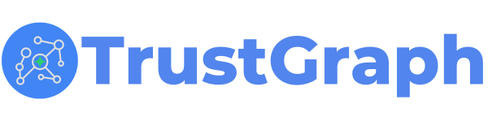

<div align="center">



[](https://hub.docker.com/u/trustgraph) [](https://pypi.org/project/trustgraph/)  
[](https://discord.gg/kT5dAsaj8v)

[**Playground**](https://docs.google.com/forms/d/e/1FAIpQLSeTnF22ZjUP20FWV--VvS5606x-5cOvnKty6AqcPdtlnPuqbQ/viewform) | [**Self-Host**](https://config-ui.demo.trustgraph.ai/) | [**Docs**](https://docs.trustgraph.ai) | [**YouTube**](https://www.youtube.com/@TrustGraphAI?sub_confirmation=1) | [**Discord**](https://discord.gg/sQMwkRz5GX) | [**Website**](https://trustgraph.ai) 

### The open-source ontology runtime for AI agents

<a href="https://trendshift.io/repositories/17291" target="_blank"></a>

**Your ontology. Your agents. Your rules.**

</div>

---

Every platform now sells you an ontology. [TrustGraph](https://trustgraph.ai) is the one you own.
 
For enterprises deploying AI agents where decisions carry real risk, TrustGraph is the **open-source ontology runtime** that turns your documents and data into ontology-grounded knowledge, and governs what every agent and user can see from it.
 
Unlike other platform ontologies, TrustGraph is built on W3C standards (RDF, OWL, SHACL, PROV-O) for total ownership and portability of your knowledge and business logic. Your ontology, your knowledge, and your audit trail stay yours, portable across any cloud, model or deployment.

## How it works

```
   Your ontology                       Your documents & data
        │                                       │
        └──────────────────┬────────────────────┘
                           ▼
                ┌──────────────────────┐
     1. EXTRACT │     OntologyRAG      │  Triples that match your classes and properties,
                │                      │  checked against domain/range constraints
                └──────────┬───────────┘
                           ▼
                ┌──────────────────────┐
     2. GROUND  │    Context Graph     │  RDF knowledge in named graphs,
                │                      │  with PROV-O lineage to every source chunk
                └──────────┬───────────┘
                           ▼
                ┌──────────────────────┐
     3. GOVERN  │  SHACL-AF Policies   │  Every query evaluated per node:
                │                      │  Allowed · Filtered · Violation
                └──────────┬───────────┘
                           ▼
              GraphRAG · SPARQL · Agents · MCP
              + a queryable trace of how each answer was produced
```
 
## What makes it different
 
| | TrustGraph | Platform ontologies |
|---|---|---|
| **Data model** | W3C RDF, OWL, JSON-LD | Vendor object model |
| **Where it runs** | Docker, Podman, Kubernetes, any cloud, on-prem or self-hosted models | Inside one vendor's data estate |
| **Knowledge source** | Documents (PDF, DOCX, XLSX, PPTX, HTML, Markdown, CSV), images, and structured data | Mostly warehouse tables and metadata |
| **Access control** | SHACL-AF policies evaluated on every query | Platform permissions |
| **Audit trail** | PROV-O in queryable named graphs | Platform logs |
| **Models** | All major LLM APIs, hosted or self-hosted open weight models | Platform's choice |
| **License** | Apache 2.0 | Commercial |
 
## Core capabilities
 
### 1. Own it: open standards, portable knowledge
- Knowledge is stored as RDF, including language tags, XSD datatypes and RDF-star quoted triples.
- Load knowledge as Turtle or TriG (named graphs preserved); export the graph as Turtle.
- Package knowledge into **Context Cores** that carry triples, embeddings, provenance and source documents between deployments.
- Move whole workspaces between deployments with portable `.tgx` bundles (`tg-export-workspace` / `tg-import-workspace`).
### 2. Use it: ontology to knowledge
- **OntologyRAG** uses your ontology to guide extraction. A similarity-based selector picks the relevant part of the ontology for each chunk, with a bypass mode for small ontologies.
- Extracted triples are validated against ontology **domain and range constraints, including the subclass hierarchy**. Triples that break the rules are rejected.
- `rdf:type` attributes are stored with graph embeddings, so you can filter vector searches by entity type.
- Schema-free **GraphRAG** and hybrid (BM25 + vector) **DocumentRAG** are also available, both with cross-encoder reranking.
### 3. Govern it: policy-based query filtering (new in 2.10)
- Write access policies as **SHACL-AF** shapes, stored in the `urn:graph:policy` named graph.
- Every graph query is evaluated node by node with a tri-state result: **Allowed**, **Filtered** or **Violation**.
- Policies apply across the REST API, SPARQL and GraphRAG, using a per-request user context.
- Each evaluation publishes a structured `policy.evaluation` audit event.
- With no policies loaded, the system runs in open mode.
### 4. Steer it: guided graph traversal (new in 2.10)
- Supply grounding seeds or graph seeds to skip LLM concept extraction.
- Restrict each hop by type, relationship or named graph, and filter edges by language tag.
### 5. Prove it: explainability
- Extraction emits **PROV-O** lineage from document to page, chunk and edge (`urn:graph:source`).
- GraphRAG, DocumentRAG and agent queries record full reasoning traces (`urn:graph:retrieval`).
- Inspect them with `tg-show-explain-trace` and `tg-show-extraction-provenance`, or query them with SPARQL.
### 6. Decide fast (new in 2.10)
- **Decision Scoring** (Laya, ONNX Runtime, ~35 ms per call): pick an option, score on an ordered scale, or get a yes/no confidence.
- **Cloze Classification**: auto-train a DistilBERT classifier from labeled examples and serve it with confidence scores.
## Agents and APIs
 
- **Agent orchestrator** with ReAct, Plan-then-Execute and Supervisor patterns.
- **MCP server** with tools for graph queries, SPARQL, GraphQL over structured data and embeddings, with bearer-token authentication.
- **SPARQL 1.1** query service with 30+ built-in functions and streaming results.
- REST, WebSocket, Python SDK, TypeScript libraries and a full `tg-*` CLI.

## Quickstart

No need to clone the repo unless you are building from source. TrustGraph deploys as a set of Docker containers. Configure it on the command line in one step:

```
npx @trustgraph/config
```

The config process will generate an app config that can be run locally with Docker, Podman, or Minikube. The process will output:
- `deploy.zip` with either a `docker-compose.yaml` file for a Docker/Podman or `resources.yaml` for Kubernetes
- Deployment instructions as `INSTALLATION.md`

For a browser based configuration, try the [Configuration Terminal](https://config-ui.demo.trustgraph.ai/). 

## Standards support
 
| Standard | Use in TrustGraph |
|---|---|
| RDF (incl. RDF-star) | Graph data model, with language tags and datatypes |
| OWL / RDFS | Ontology classes and properties; domain, range and subclass checks during extraction |
| SHACL-AF | Policy-based query filtering |
| PROV-O | Extraction lineage and query-time reasoning traces |
| SPARQL 1.1 | Querying knowledge, provenance and policies |
| Turtle / TriG / N-Quads | Import and export |
| MCP | Agent integration |
 
> **Note on scope:** TrustGraph uses OWL ontologies to guide extraction and to check domain, range and subclass constraints. It is not a full OWL reasoner. See the [Ontologies](https://docs.trustgraph.ai/learn/ontologies.html) docs for details.
 
## Integrations
 
- **LLMs:** All major LLM APIs, including OpenAI and compatible providers, Claude, Gemini (GCP and AI Studio), Near AI, AWS Bedrock, Azure, Mistral, Cohere, Ollama, vLLM, LM Studio, TGI and llama.cpp
- **Messaging:** Apache Pulsar or RabbitMQ (Kafka experimental)
- **Storage:** Cassandra (graph), Qdrant (vectors), S3-compatible object storage
- **Documents:** Docling decoder for PDF, DOCX, XLSX, PPTX, HTML, Markdown and CSV
- **Deployment:** Docker / Podman Compose, Minikube, Azure AKS, GCP, AWS, Scaleway, OVHcloud; amd64 and arm64 images; Nvidia, AMD, and Intel GPU support
- **Security:** IAM with JWT and API keys, workspace multi-tenancy, fine-grained capabilities

## Getting Started with TrustGraph

- [**Getting Started Guides**](https://docs.trustgraph.ai/)
- [**Build an App**](https://docs.trustgraph.ai/build-an-app/)
- [**Developer APIs and CLI**](https://docs.trustgraph.ai/reference)
- [**Deployment Guides**](https://docs.trustgraph.ai/deployment)

## TypeScript Library for UIs

There are TS libraries for quick UI integration of TrustGraph services.

| Package | Description |
|---|---|
| `@trustgraph/trustkit` | Shared component library and design system |
| `@trustgraph/client` | TypeScript client for TrustGraph APIs |
| `@trustgraph/react-provider` | React provider for TrustGraph WebSocket connections |
| `@trustgraph/react-state` | React state management hooks |
| `@trustgraph/portal` | Portal application showcasing all workflows |

## Contributing

[Developer's Guide](https://docs.trustgraph.ai/guides/building/introduction.html)

## License

**TrustGraph** is licensed under [Apache 2.0](https://www.apache.org/licenses/LICENSE-2.0).

   Copyright 2024-2026 TrustGraph

   Licensed under the Apache License, Version 2.0 (the "License");
   you may not use this file except in compliance with the License.
   You may obtain a copy of the License at

       http://www.apache.org/licenses/LICENSE-2.0

   Unless required by applicable law or agreed to in writing, software
   distributed under the License is distributed on an "AS IS" BASIS,
   WITHOUT WARRANTIES OR CONDITIONS OF ANY KIND, either express or implied.
   See the License for the specific language governing permissions and
   limitations under the License.

## Support & Community
- Bug Reports & Feature Requests: [Discord](https://discord.gg/sQMwkRz5GX)
- Discussions & Questions: [Discord](https://discord.gg/sQMwkRz5GX)
- Documentation: [Docs](https://docs.trustgraph.ai/)
