## The Platform

## Ontologies Made Easy

## Understand Your Knowledge

## 3 RAG Techniques in a Single Platform

## Advanced Agentic Graph Traversal

## Semantic Policy Enforcement

## Provenance for Knowledge and Agent Actions

## Decisions without LLMs

